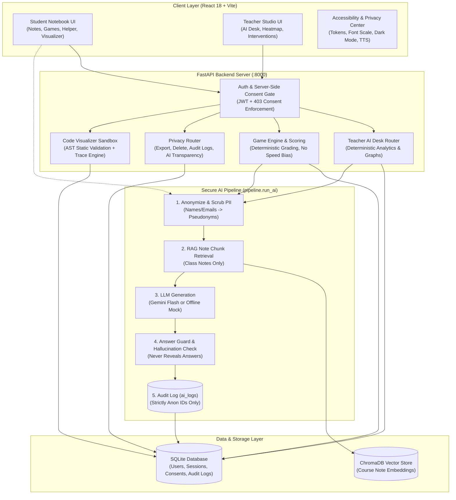

# LearnAI – Calm Studio Notebook & AI-Powered Classroom Platform

> **Hackathon MVP · Phase 8 Complete** · Grounded Curriculum Notes → Interactive Practice Games → Deterministic Diagnostics → Teacher AI Desk

LearnAI is an ethical, privacy-first classroom platform engineered to solve the 1-to-40 instruction dilemma: teachers cannot manually design 40 custom lesson plans, while raw generative AI hallucinates, leaks student privacy, and enables cheating. LearnAI puts **the teacher firmly in the loop**: curriculum notes are drafted with verified source citations, interactive games require comprehension recall to unlock, code animates step-by-step with state inspection, and deterministic learning analytics pinpoint prerequisite knowledge gaps (e.g. loops failing because of weak variables) so teachers can approve targeted support tasks in one click.

---

## 🎯 Hackathon Brief Mapping

| Stage | Feature in LearnAI | Implementation |
|---|---|---|
| **Input** | Grounded Curriculum Ingestion | Approved markdown notes indexed into ChromaDB vector store; student recall quizzes verify comprehension before games unlock. |
| **Analysis** | Deterministic Learning Analytics | Recency-weighted mastery calculations across curriculum DAGs; automatic attention flagging with prerequisite root-cause tracing (code computes, AI only explains). |
| **Recommendation** | Targeted Teacher-Approved Interventions | One-click support task builder generates fill-the-blank, bug hunt, or visualizer tasks targeted to struggling student cohorts; requires explicit teacher approval. |
| **Teacher in the Loop** | Teacher Authority & Safe Chat | AI drafts are locked in DRAFT status until human approval; two-step safe desk chat answers questions without executing autonomous student changes. |
| **Privacy & Ethics** | Privacy-by-Design Architecture | Deterministic regex PII scrubbers, server-side consent gate, student data export, teacher-approved deletion with aggregate preservation, and zero student rankings. |

---

## 🏗️ Architecture Diagram



---

## ⚡ Setup in Under 5 Minutes

### Prerequisites
- Python 3.11+
- Node.js 18+ and npm

### 1. Backend Setup (Terminal 1)

```bash
cd backend

# Create virtual environment
python -m venv .venv

# Activate virtual environment
# Windows:
.venv\Scripts\activate
# macOS/Linux:
source .venv/bin/activate

# Install dependencies
pip install -r requirements.txt

# Populate database with rich demo data
python seed.py

# Launch FastAPI backend
uvicorn app.main:app --reload --port 8000
```
Backend API will be running at `http://localhost:8000` (Swagger docs: `http://localhost:8000/docs`).

### 2. Frontend Setup (Terminal 2)

```bash
cd frontend

# Install dependencies
npm install

# Start Vite development server
npm run dev
```
Frontend application will be running at `http://localhost:5173`.

---

## 🤖 Switching Between Mock and Live AI

LearnAI operates **100% offline with zero API keys required by default**:
- **Offline / Mock Mode (Default)**: When `LLM_API_KEY=""` in `.env` (or omitted), the platform uses local mock synthesis. All RAG grounding, prompt anonymization, answer guards, and support task drafts work offline with realistic demo data.
- **Live Gemini Mode**: Create `backend/.env` with:
  ```env
  LLM_API_KEY=your_gemini_api_key_here
  LLM_MODEL=gemini-2.0-flash
  ```

---

## 👥 Demo Logins

| Role | Username (anon_id) | Password | Notes |
|---|---|---|---|
| **Teacher** | `T-001` | `teach123` | Full access to Teacher AI Desk, analytics heatmap, class export, support tasks. |
| **Student (Consented)** | `S-001` | `student123` | Alex: Has consented to v1.0. Demonstrates note reader, quizzes, game player. |
| **Student (Attention Cohort)** | `S-004` | `student123` | Casey: High severity attention flag (loops failing due to variables gap). |
| **Student (Unconsented)** | `S-012` | `student123` | Emery: Has NO consent record. Demonstrates the Grade 8 Consent Screen flow! |

---

## 🛡️ Privacy and Ethics by Design

- **Server-Side Consent Enforcement**: Unconsented students get `403 Forbidden` on all protected endpoints. Bumping `consent_version` in config immediately forces re-consent.
- **Strict Anonymization**: Student real names, emails, and contact details are NEVER transmitted to external LLMs. Audit logs (`ai_logs`, `access_log`, `deletion_audit_log`) strictly store pseudonyms (`S-004`, `T-001`).
- **Teacher in Control**: AI drafts are created in `status="draft"` with visible source badges. Content never auto-publishes to students without teacher approval.
- **Deterministic Analytics**: Topic mastery, forgetting penalties, prerequisite tracing, and flags are computed strictly in deterministic Python code. AI only summarizes and explains.
- **GDPR / FERPA Data Rights**: Students can view stored data categories (`/privacy/my-data`) and download a JSON export. Deletion requests require teacher approval, upon which personal data is hard deleted and sessions are preserved as anonymized aggregates so class learning analytics stay valid.
- **No Leaderboards or Public Rankings**: Eliminates social anxiety and unhealthy gamification; progress is tracked purely by personal streaks and mastery.

---

## ♿ Accessibility & Design System

- **Calm Studio / Notebook Aesthetic**: Warm off-white (`#FAF8F4`), ink text (`#1C1917`), deep teal accent (`#0F766E`), and sparing amber for points.
- **Accessibility Drawer (`Alt + A`)**:
  - Fonts: Inter, Atkinson Hyperlegible, OpenDyslexic.
  - Text Scaling: 100%, 125%, 150%, 200% with no broken layouts.
  - Line height and letter spacing toggles.
  - High-contrast mode and reduced motion support.
- **SpeechSynthesis Read Aloud**: "Listen" button on notes and helper replies reads text aloud client-side with sentence tracking and zero data leaving the machine.
- **Keyboard & Screen Readers**: Full tab order, visible focus rings, shortcuts modal (`?`), skip-to-content link, and "View as Table" toggle on charts and heatmaps.
- **Touch-Friendly**: Tested with 44px minimum touch targets and mobile responsive layouts down to 360px.

---

## ⚠️ Known Limitations

1. **Python Sandbox**: Subprocess execution utilizes AST validation and resource limits. For hostile production environments with arbitrary public code, container isolation (Docker/gVisor/Firecracker) should be added.
2. **Synthetic Data**: Seed data represents synthetic classroom performance scenarios for testing and demonstration.
3. **Legal Translations**: The 5-language consent strings are provided as human-written static translations for hackathon demonstration and should be reviewed by accredited legal counsel prior to commercial school deployment.

---

## 🔮 Future Work

- **Handwritten Homework OCR**: Photo upload and automatic line-by-line digitizing into student notes.
- **Whisper Speech Input**: Multi-lingual voice questions for younger learners.
- **LMS Canvas / Google Classroom Sync**: Two-way roster and gradebook import/export.
- **Additional Subject Graphs**: Prerequisite trees for algebra, physics, and introductory statistics.

---

## 📸 Key Screenshot Placeholders

- `screenshots/01_teacher_ai_desk_heatmap.png`: Teacher AI Desk showing class topic heatmap and prerequisite chain.
- `screenshots/02_attention_flags_prereq_trace.png`: Student attention card showing S-004 flagged for loops due to weak variables.
- `screenshots/03_student_consent_multilingual.png`: Grade 8 multilingual consent screen with 5 language toggles.
- `screenshots/04_student_note_read_aloud.png`: Student note reader with "Listen" button and simple language summary badge.
- `screenshots/05_code_visualizer_stepper.png`: Line-by-line code execution visualizer with call stack and variable frames.
- `screenshots/06_privacy_center_my_data.png`: Privacy Center showing data categories and JSON export button.
- `screenshots/07_accessibility_drawer_settings.png`: Universal accessibility drawer with Atkinson font and 200% text scaling.

---

## 🧪 Running the Test Suite

```bash
# Backend pytest suite (53 unit, integration, and privacy tests)
cd backend
python -m pytest -v -o pythonpath=.

# Run data retention purge
python -m app.privacy.purge

# Frontend build & type check
cd ../frontend
npm run build
```
